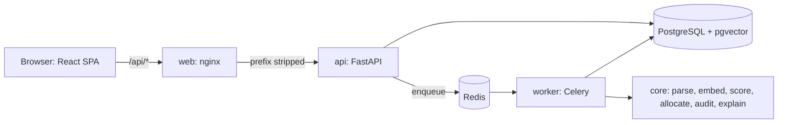

# FairMatch AI

[](https://github.com/Sejal-07661/fairmatch-ai/actions/workflows/ci.yml)

FairMatch AI matches candidates to internships and jobs. It reads resumes and postings, scores every candidate/posting pair (semantic similarity, skill overlap, experience, education), allocates candidates to seat-limited postings with either the Hungarian algorithm or Gale-Shapley, audits the outcome for group fairness (selection rate, disparate impact, four-fifths rule) and explains each match. Admins use a React dashboard to manage opportunities and candidates, start runs, compare the two algorithms and read the fairness audit; candidates upload a resume and see their extracted skills.

It is a final-year project. The scoring, allocation and fairness code is a pure Python package (`fairmatch/core`) with no web or database imports; the API, worker and dashboard are layers around it.

## Architecture



Details: [docs/ARCHITECTURE.md](docs/ARCHITECTURE.md). Fairness metrics and their limits: [docs/FAIRNESS.md](docs/FAIRNESS.md). Deployment and configuration: [docs/DEPLOYMENT.md](docs/DEPLOYMENT.md).

## Quick start with Docker

Status: the Docker path is verified by static tests and the CI image build only. It was not run end to end on the author's machine (the Docker daemon was off), so treat the first `up` as the real test.

Needs Docker with Compose v2. The first build downloads the embedding model (BAAI/bge-small-en-v1.5) into the image, so it needs internet access and some minutes.

```bash
cp .env.example .env
python -c "import secrets; print(secrets.token_urlsafe(48))"   # paste the output as JWT_SECRET in .env
# also set POSTGRES_PASSWORD in .env
docker compose up --build
```

PowerShell: `Copy-Item .env.example .env`, the rest is identical.

Without a real `JWT_SECRET` and `POSTGRES_PASSWORD` in `.env`, compose stops with `set JWT_SECRET in .env` (or `POSTGRES_PASSWORD`). Create the first admin (in another terminal, once the stack is up):

```bash
docker compose run --rm api python -m api.cli create-admin admin@example.com 'a-strong-password'
```

Then open <http://localhost:8080> and sign in. (`WEB_PORT` in `.env` changes the port; port 8000 is not used on the host.) New sign-ups through `/register` are always candidates; admins can only be created with the command above (which also promotes an existing user).

## Local development without Docker

Needs Python 3.13 and Node 22 (Node 20+ should work). Commands run from the repo root.

Backend (from `fairmatch/`). With no `DATABASE_URL` the API uses a local SQLite file, and `CELERY_EAGER=true` runs tasks inline, so no PostgreSQL, Redis or worker is needed:

```bash
cd fairmatch
pip install -r requirements-dev.txt
export JWT_SECRET=dev-secret CELERY_EAGER=true REDIS_URL=fakeredis://
python -m alembic upgrade head
python -m api.cli create-admin admin@example.com 'a-strong-password'
python -m uvicorn api.main:create_app --factory --port 8765
```

```powershell
cd fairmatch
pip install -r requirements-dev.txt
$env:JWT_SECRET = "dev-secret"; $env:CELERY_EAGER = "true"; $env:REDIS_URL = "fakeredis://"
python -m alembic upgrade head
python -m api.cli create-admin admin@example.com 'a-strong-password'
python -m uvicorn api.main:create_app --factory --port 8765
```

Frontend (from `frontend/`), pointing the dev proxy at that API:

```bash
cd frontend && npm ci
VITE_API_TARGET=http://127.0.0.1:8765 npm run dev     # http://localhost:5173
```

```powershell
cd frontend; npm ci
$env:VITE_API_TARGET = "http://127.0.0.1:8765"; npm run dev
```

To run PostgreSQL and Redis locally instead, see [fairmatch/README.md](fairmatch/README.md).

### Tests

```bash
cd fairmatch && python -m pytest -m "not slow and not llm and not db" -q && python -m ruff check . && python scripts/export_openapi.py --check
cd frontend && npm test && npm run typecheck && npm run lint && npm run build && npm run test:deploy
cd frontend && npm run e2e      # real backend on port 8765 + Vite on 5173; see frontend/e2e/README.md
```

PowerShell: run the same commands as separate lines (Windows PowerShell 5.1 has no `&&`). The PostgreSQL tests (`pytest -m db`) need `TEST_DATABASE_URL` and run in CI; the `slow` and `llm` markers need the real model or an API key.

An optional end-to-end demo of the core pipeline without any server: `cd fairmatch && python demo.py`.

## Repository map

| Path | Contents |
|---|---|
| `fairmatch/core/` | Pure pipeline: parser, embeddings, scoring, allocation, compare, fairness, explain |
| `fairmatch/api/` | FastAPI app, models, Celery worker, services; `migrations/` holds Alembic revisions |
| `fairmatch/openapi.json` | Committed API contract snapshot; the frontend types are generated from it |
| `fairmatch/Dockerfile`, `fairmatch/docker/` | Backend image and entrypoint |
| `frontend/` | Vite + React + TypeScript dashboard; `deploy/nginx.conf` and `Dockerfile` for the web image; `e2e/` Playwright tests |
| `docker-compose.yml`, `.env.example` | The deployable stack and its configuration template |
| `.github/workflows/ci.yml` | CI: backend, frontend, e2e, docker build |
| `docs/` | Architecture, deployment, fairness; `superpowers/` has the design spec, plans and review reports |

Component READMEs: [fairmatch/README.md](fairmatch/README.md), [frontend/README.md](frontend/README.md).

## Known limitations

- No audit-trail view in the dashboard. Run history (`/runs`) and per-run allocations, fairness and explanations exist, but who requested a run and the scoring weights are not exposed.
- PostgreSQL and pgvector are verified only offline in this repo's local test runs and by the `pytest -m db` job in CI; day-to-day local tests use SQLite.
- The Docker path is verified by static tests and the CI image build only (see above).
- On the no-API-key path, education is detected by regular expressions, which have edge cases (unusual degree spellings can be missed or misread). Set `OPENAI_API_KEY` for LLM parsing.
- When the API is used without the nginx proxy, an oversized upload is already received (and spooled to disk by the multipart parser) before the API's 5 MiB check rejects it; the nginx `client_max_body_size 6m` in the Docker stack prevents this. Run a body-size-limiting proxy in front of any other deployment.
