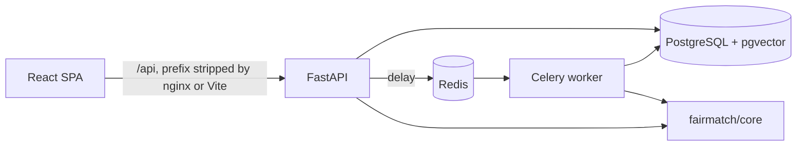

# Architecture

Back to the [README](../README.md). Related: [DEPLOYMENT.md](DEPLOYMENT.md), [FAIRNESS.md](FAIRNESS.md), design spec [superpowers/specs/2026-11-02-fairmatch-design.md](superpowers/specs/2026-11-02-fairmatch-design.md).

## Layers

`fairmatch/core` imports nothing from the web or database layers, so each stage is unit-testable with plain data. The API (`fairmatch/api`) loads rows, calls core and stores results. Redis is the Celery broker and result backend and holds the embedding cache.

## Matching pipeline (`core/pipeline.py`, `run_pipeline`)

1. **Parse** (`core/parser.py`). With `OPENAI_API_KEY` set an LLM extracts skills, years of experience and education level; otherwise (or on any LLM failure) a spaCy phrase matcher over the skill taxonomy (`core/data/skills.json`) plus regexes for experience and education is used. Rows record `used_fallback`.
2. **Embed** (`core/embeddings.py`). `BAAI/bge-small-en-v1.5` via sentence-transformers, L2-normalised. It loads from the local cache first (`local_files_only=True`) and goes online only on a cache miss; the Docker image pre-downloads it at build time.
3. **Score** (`core/scoring.py`). For each candidate/posting pair: `0.4 * semantic + 0.4 * skills + 0.1 * experience + 0.1 * education` (the default `ScoreWeights`; they must sum to 1). Semantic is the cosine similarity clipped to [0, 1]. Skills: each required skill earns 1.0 for an exact (taxonomy-canonical) match or 0.5 for a related skill, divided by the number of required skills. Experience is `min(1, years / minimum)`; education is 1 when the level meets the minimum, else `level / minimum`. Every pair keeps a `ScoreBreakdown`.
4. **Allocate** (`core/allocation.py`). Both algorithms respect posting capacity:
   - *Hungarian* (`scipy.optimize.linear_sum_assignment` on a seat-expanded matrix) maximises the total score. Ties are broken deterministically toward lower indices.
   - *Gale-Shapley* is candidate-proposing: each candidate proposes in score order, and a posting keeps its highest-scoring candidates up to capacity. It yields a stable matching but not necessarily the highest total.
   `core/compare.py` reports total score, blocking pairs (instability) and runtime for each.
5. **Audit** (`core/fairness.py`). Selection rate per group, disparate impact ratio, four-fifths check, parity difference. See [FAIRNESS.md](FAIRNESS.md).
6. **Explain** (`core/explain.py`). Reasons are built from the score breakdown (grounded in data). With an LLM key a narrative is added; otherwise the narrative is deterministic and flagged `used_fallback`.

A run is limited to `candidates x total seats <= 25,000,000` (`MAX_CELLS` in `api/services/runs.py`), because the Hungarian solver expands seats.

## Data model (`api/models.py`, migrations in `fairmatch/migrations/versions`)

| Table | Notes |
|---|---|
| `users` | email (unique), bcrypt hash, role `candidate` or `admin` |
| `candidates` | one per user; resume text, parsed skills (JSON), experience years, education level, `embedding` |
| `candidate_demographics` | `candidate_id` -> `group_label`; admin-only |
| `opportunities` | title, posting text, required skills, capacity, minimums, `embedding` |
| `allocation_runs` | algorithm (`hungarian`, `gale_shapley`, `both`), `status` (`pending`, `running`, `done`, `failed`), `error`, `metrics`, `fairness`, `created_at`, `started_at`, `finished_at` |
| `allocations` | per run and algorithm: candidate, opportunity, score, breakdown, reasons, narrative |

On PostgreSQL the `embedding` columns are pgvector `vector` columns with HNSW cosine indexes (migration `0001`); elsewhere they are stored as JSON and similarity is computed in Python. `0002` adds `allocation_runs.started_at`.

## Run flow (Celery)

1. `POST /runs` (admin) validates preconditions (candidates, opportunities, seats, size limit), stores a `pending` run and enqueues `api.run_allocation`; it answers 202, or 503 (marking the run `failed`) if the queue is unreachable. Profile creation similarly enqueues `api.embed_profile`.
2. The worker claims the run atomically (`pending`/`failed` -> `running`, `started_at = now`), runs the pipeline and writes allocations, metrics and fairness; any exception ends the run as `failed` with a truncated error message.
3. The dashboard polls `GET /runs/{id}` every 1.5 s while the run is `pending` or `running`.
4. With `CELERY_EAGER=true` tasks run inline in the API process (tests and quick local development).

### Reclaiming stuck runs

`reclaim_stuck_runs` runs when a worker starts (`worker_ready` signal in `api/worker.py`) and then every 5 minutes through the Celery task `api.reclaim_stuck` (`beat_schedule`; the compose worker runs with `-B`):

- `running` runs whose `started_at` is older than `RUN_TIMEOUT_MINUTES` (default 30), or missing, are reset to `pending`;
- `pending` runs older than `PENDING_GRACE_MINUTES` (default 5) are treated as never enqueued;
- all of those ids are re-enqueued. A fresh `running` run is left alone, and `execute_run` only takes over a `running` row whose `started_at` has expired, so a live run is not executed twice.

A killed worker (or a dead prefork child) is therefore recovered within `RUN_TIMEOUT_MINUTES` plus at most 5 minutes, without waiting for a restart. Running runs are reset with a single guarded `UPDATE ... WHERE status='running' AND (started_at IS NULL OR started_at < cutoff)`, so a run claimed concurrently by another worker is never overwritten. Run in more than one worker container only with the understanding that each runs its own beat; the sweep is idempotent, so this is harmless.

## Auth and roles

- `POST /auth/register` always creates a `candidate`. Admins come only from `python -m api.cli create-admin EMAIL PASSWORD`.
- `POST /auth/login` returns an HS256 JWT (`sub`, `role`, `exp`; lifetime `ACCESS_TOKEN_MINUTES`). The algorithm is pinned on decode. Passwords are bcrypt (8 characters to 72 bytes).
- Candidates can create and read only their own profile. Everything else (candidate lists, demographics, runs, explanations, similarity search) is admin-only; opportunities can be read by any signed-in user.
- The dashboard keeps the token in `sessionStorage` and hides admin routes from candidates, but the server enforces roles.
- Every error response is `{"detail": "<message>"}`, including 422 and unhandled 500s.

## Privacy rule

Demographic group labels are stored in a separate table and are read only to build the `group_of` mapping for `fairness.audit` in `api/services/runs.py`. They are not inputs to parsing, scoring, allocation or explanations, and no candidate-facing response includes them. If any candidate lacks a label the run still completes and the fairness section is skipped with a note (`fairness_skipped` in the run metrics).

## Frontend

Vite + React + TypeScript with TanStack Query. Admin pages (opportunities, runs, run detail with Recharts charts) are lazy-loaded. Types are generated from the committed `fairmatch/openapi.json`. In production nginx serves the built files, falls back to `index.html` for deep links such as `/runs/3`, returns a real 404 for a missing `/assets/*` file, proxies `/api/` to the API with the prefix stripped, rejects bodies over 6 MiB, and sets a strict Content-Security-Policy and other security headers (`frontend/deploy/nginx.conf`).
